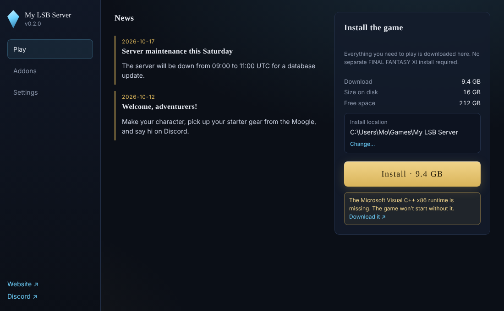

# XI Launcher

A HorizonXI-style launcher for a [LandSandBoat](https://github.com/LandSandBoat/server) private server, built with Electron + React.



What it does:

- **Ships the whole game** (`clientMode: "bundled"`, like HorizonXI): players install the launcher, press **Install**, and get FFXI + PlayOnline + Ashita + xiloader in one folder. It runs through Ashita's **Sandbox** plugin, so there's no retail install, no registry entries and no admin rights needed.
- **Or uses the player's own retail install** (`clientMode: "retail"`), found through the PlayOnline registry key or a folder they pick.
- **Patches everything** from a manifest on any static web host: gzip-compressed, content-addressed, SHA-256 verified, 8 parallel downloads, pause/resume, free-space check, "Verify game files" repair. Only changed files download on updates, and files you remove from the client get removed from players' machines.
- **Signs in and launches** through Ashita v4 → xiloader → your login server. The password goes to xiloader via a short-lived `--json` file, so it never appears in the process list. "Remember me" stores it with the OS keychain (DPAPI on Windows).
- **Manages addons/plugins** with toggles; you can mark some as required or on by default, and publish an optional catalog players install extra addons and plugins from.
- **Shows a news feed** and **game settings** (resolution, window mode, graphics, sound, gamepad), written into the Ashita boot profile's `[ffxi.registry]` section on every launch.

## 1. Configure it for your server

Edit `launcher.config.json`:

| Key | Meaning |
| --- | --- |
| `clientMode` | `"bundled"` ships the full game (see "Shipping the full client"). `"retail"` uses the player's own install. |
| `clientLanguage` | Region of the bundled client: `US`, `EU` or `JP`. Ignored in retail mode, where players pick theirs. |
| `serverId` | Short id; the launcher writes `Ashita/config/boot/<serverId>.ini` and `Ashita/scripts/<serverId>.txt`. |
| `serverName` | Window title and branding. |
| `serverHost` | Hostname/IP of your LSB login server (passed as `--server`). |
| `manifestUrl` | URL of `manifest.json` (see step 2). Empty disables patching. |
| `newsUrl` | URL of a `news.json` (see `server-example/news.json`). Empty hides news. |
| `links` | Sidebar links, e.g. website and Discord. |
| `hairpin` | Pass `--hairpin` to xiloader (only for a home-hosted server you also play on). |
| `ports` | Optional `auth` / `data` / `view` port overrides if you changed LSB's defaults (54231 / 54230 / 54001). |
| `requiredPlugins`, `defaultPlugins`, `requiredAddons`, `defaultAddons` | Addon policy. Required ones can't be turned off. |
| `addonCatalogUrl` | URL of an `addons.json` listing optional addons and plugins players can install (see "Addon and plugin catalog"). Empty shows only what ships with the client. |
| `linux` | Optional Linux runtime overrides: `protonVersion` (e.g. `"GE-Proton10-25"` to pin a version; empty = latest), `protonUrl` and `umuUrl` (host the GE-Proton `.tar.gz` and umu-launcher zipapp yourself, e.g. on your LAN file server). |
| `pivotCatalogUrl` | URL of a `pivot.json` listing optional HD/DAT packs (see "Pivot: HD packs"). Empty hides the catalog. |
| `verifyLogin` | `true` (default): Play first checks the username and password with the login server, so mistakes show in the launcher, then xiloader logs in automatically. |
| `registerUrl` / `accountUrl` | Your website's sign-up page and account page (e.g. `https://example.com/register`, `https://example.com/account`). When set, **Create account** opens the website and a **My characters** link appears. |
| `allowAccountCreation` | Show **Create account** in the launcher (default `true`). The server also needs `ACCOUNT_CREATION = true` in `settings/login.lua`. |
| `scriptBinds` | Keybinds written to the Ashita startup script. Defaults to Ashita's standard binds (Insert opens the Ashita menu, Print Screen takes a clean screenshot, Ctrl+V pastes, F11 ambient light, F12 FPS display). |
| `scriptCommands` | Ashita commands run for every player once addons have loaded, e.g. `["/echo Welcome!"]`. |
| `requiredOverlays` | XIPivot overlay folders you ship in the client (`Ashita/polplugins/DATs/<name>`) that are always on, e.g. custom server DATs. |

For a custom icon, put a 256×256 `icon.ico` in `resources/` and add `"icon": "resources/icon.ico"` under `build.win` in `package.json`.

## 2. Shipping the full client (bundled mode)

> The FINAL FANTASY XI and PlayOnline files are Square Enix's copyrighted software. Redistributing them is what HorizonXI and other private servers do, but whether to do it is your decision and your risk.

### Prepare the ingredients (on a Windows PC)

1. **A clean, fully patched retail install.** Install FFXI from Square Enix's official download page, run PlayOnline and use **Check Files** to bring FFXI up to date, then close PlayOnline. Use a fresh install that has never logged into a real account, so no personal data is in it. LandSandBoat's default `VER_LOCK = 2` requires the client to be at least the `CLIENT_VER` in `settings/default/login.lua`, so check that your server's setting matches the version you package.
2. **Ashita v4:** `git clone https://github.com/AshitaXI/Ashita-v4beta`. It already includes `polplugins/sandbox.dll` and `config/sandbox/*.ini`.
3. **xiloader:** the latest `xiloader.exe` from https://github.com/LandSandBoat/xiloader/releases. Ashita's own `bootloader/pol.exe` is an older Ashita v3-era loader and is left out.
4. **(Optional) an overlay folder** for anything of your own, laid out like the final client, e.g. `overlay/Ashita/addons/myaddon/…`, extra plugins, custom DATs, or `overlay/Ashita/config/sandbox/sandbox.ini` overrides.

### Build and publish

```bash
node tools/build-client.mjs \
  --ffxi     "C:/Program Files (x86)/PlayOnline/SquareEnix/FINAL FANTASY XI" \
  --pol      "C:/Program Files (x86)/PlayOnline/SquareEnix/PlayOnlineViewer" \
  --ashita   ./vendor/Ashita-v4beta \
  --xiloader ./vendor/xiloader.exe \
  --overlay  ./overlay \
  --out      ./client

node tools/make-manifest.mjs ./client ./publish --gzip --version 2026.10.13-1
```

`build-client` checks that the key files exist, then copies everything into this layout (`--link` hard-links instead of copying if the source is on the same drive):

```
client/
  Ashita/                              Ashita v4 (+ Sandbox), xiloader in Ashita/bootloader/
  Game/SquareEnix/FINAL FANTASY XI/
  Game/SquareEnix/PlayOnlineViewer/
  client.json                          build date + fingerprint of the game binaries
```

It never copies personal or machine-specific data: FFXI `USER/` (characters, macros), screenshots, PlayOnline `usr/` (saved accounts), `data/icon/cicn_m000.png` (POL's local encryption key), Ashita boot profiles, addon settings and `sps000.bin`.

`make-manifest` writes `publish/manifest.json` and gzip-compressed blobs in `publish/files/ab/abcdef….gz`. Upload `publish/` to a static host (S3, Cloudflare R2, Backblaze B2 + CDN, nginx…), **blobs first, `manifest.json` last**, and set `manifestUrl`. Every new player downloads the full client, so choose a host with cheap egress.

### Updating the client later

Patch your source install (or change the overlay), then re-run both commands with the **same** `publish` directory. Only changed files are compressed and need uploading, and files that disappeared are listed under `"delete"` so the launcher removes them from players' machines. Because blobs are stored by content hash, players halfway through an older update aren't affected. Add `--prune` once you're sure nobody needs the old blobs.

### What happens on a player's machine

The launcher installs into the folder the player chooses (default `~/Games/<app name>`), after checking there's enough free space. On **Play**, the boot profile gets:

```ini
[ashita.polplugins]
sandbox = 1

[sandbox.paths]
common = <install>\Game\Common
pol    = <install>\Game\SquareEnix\PlayOnlineViewer
ffxi   = <install>\Game\SquareEnix\FINAL FANTASY XI
tetra  = <install>\Game\SquareEnix\TetraMaster
```

Sandbox then answers the PlayOnline/FFXI registry and COM lookups made by xiloader and the game, so they find the bundled files instead of a real install.

For a JP client, set `clientLanguage` to `JP` and ship a `sandbox.ini` override in your overlay (see `Ashita/docs/sandbox/README.md`, "Using Japanese PlayOnline").

## 3. Retail mode: host only the server files

With `clientMode: "retail"`, ship only what goes on top of the player's own install:

```
client/
  Ashita/
    ashita-cli.exe
    bootloader/xiloader.exe
    addons/...
    plugins/...
```

```bash
npm run manifest -- ./client ./publish --gzip
```

## Player settings

Everything players change in **Settings** is written into the Ashita boot profile every time they press Play:

- **Game:** install folder, sound, opening movie, hardware mouse, **frame rate** (60 fps via Ashita's `fps` addon, `/fps 1`, which is on by default), and **startup commands** (any Ashita commands, one per line).
- **Addons:** the launcher always loads Ashita's `addons` plugin when any Lua addon is enabled; addons can't run without it.
- **Graphics:** window mode and resolution, separate **background** (3D) and **menu** (UI) resolutions with "Recommended" and "Match window" shortcuts, texture/font quality, environment animation, mip mapping, bump mapping, uncompressed maps, graphics stabilization, aspect ratio.
- **Controller:** enable, enumeration, active while unfocused, XInput or DirectInput, a specific device GUID, force feedback, sliders, hat switches, and a per-action button mapping with a live diagram (`padmode000`, `padsin000`, `padguid000`). The XInput default is the common private-server layout (LB autorun, LT/RT macro palettes, A confirm, B cancel, X main menu, Y active window, D-pad menus). DirectInput keeps the game's own layout until a player customizes it.

## Pivot: HD packs

The **Addons → Pivot** tab lets players download and switch HD texture, map and UI packs. It uses [XIPivot](https://github.com/HealsCodes/XIPivot), which redirects the game's DAT reads to overlay folders, so the game files are never modified and a pack can be turned off at any time.

### 1. Add XIPivot to your client

Ashita v4 doesn't include it. Download the Ashita v4 build from the XIPivot releases page and put its files in your overlay folder so `build-client` ships them:

```
overlay/Ashita/polplugins/pivot.dll
overlay/Ashita/polplugins/DATs/            (optional: server-required overlays, see below)
```

Republish. Once `pivot.dll` is installed, the launcher loads it automatically with its own config (`Ashita/config/pivot/<serverId>.ini`), which it rewrites from the player's choices on every launch.

### 2. Publish a pack catalog

Host a `pivot.json` and set `pivotCatalogUrl` (see `server-example/pivot.json`):

```json
[
  {
    "id": "nexthd",
    "name": "NextHD",
    "category": "Textures",
    "description": "HD texture remaster.",
    "author": "Pack author",
    "links": { "Website": "https://..." },
    "url": "https://files.example.com/packs/nexthd-2.0.zip",
    "size": 6650000000,
    "sha256": "…",
    "version": "2.0"
  }
]
```

- **`url`** is a zip whose `ROM/`, `ROM2/` … folders mirror the game's. A single wrapper folder inside the zip is fine; the launcher finds the ROM folders.
- **`id`** becomes the folder name in `Ashita/polplugins/DATs/`. Use letters, digits, `-`, `_` and `.`.
- **`category`**: packs in the same category are mutually exclusive, so enabling one turns the others off. Categories appear in catalog order.
- **`sha256`** (recommended): downloads that don't match are rejected. Use `sha256sum pack.zip`, or `Get-FileHash pack.zip` on Windows.
- **`version`**: bump it to offer players an **Update** button.

Use packs whose licence allows redistribution, or link to the author's own download URL, and credit authors through `author` and `links`.

Players can also click **Add a folder…** to use a DAT mod they already have. It's linked into `DATs/` (a Windows directory junction, so nothing is copied), and removing it from the list never deletes their files.

### 3. Server-required overlays (optional)

Put custom server DATs in `overlay/Ashita/polplugins/DATs/<name>/ROM/...` and list `<name>` in `requiredOverlays`. They're delivered by the normal patcher, always enabled, and loaded first, so they win over cosmetic packs.

## Addon and plugin catalog

The **Addons** page lists what's installed (with on/off checkboxes) and, when you set `addonCatalogUrl`, an **Available** section with **Install** buttons. Host an `addons.json` next to `manifest.json` (see `server-example/addons.json`):

```json
[
  {
    "type": "plugin",
    "name": "TargetLines",
    "version": "1.0",
    "author": "Plugin author",
    "description": "Draws a line from you to your target.",
    "links": { "Source": "https://github.com/..." },
    "url": "http://10.2.5.85/launcher/addons/TargetLines-1.0.zip",
    "sha256": "…"
  }
]
```

- **`type`**: `"plugin"` (Ashita `.dll`) or `"addon"` (Lua).
- **`name`**: must match the plugin's `.dll` name or the addon's folder name, since that's what Ashita loads.
- **`url`**: a zip in one of these layouts (a single wrapper folder is fine):
  - Ashita layout: `plugins/TargetLines.dll`, `addons/<name>/<name>.lua`, `resources/…`, `docs/…`, merged into the player's `Ashita/` folder.
  - Plugin: `TargetLines.dll` at the top, with any other folders (e.g. `resources/`) merged into `Ashita/`.
  - Addon: `<name>.lua` at the top, or a `<name>/` folder containing it.
- **`version`**: bump it to offer an **Update** button. **`sha256`** (recommended) rejects corrupted downloads. **`size`** (bytes) is shown before downloading.
- **`platforms`**: `["linux"]` or `["windows"]` to offer an item on one OS only (e.g. a Wine fix plugin). Omit for both.

Installed items are turned on automatically and can be removed with ✕. The launcher records what it copied in `Ashita/config/launcher-catalog.json`, so removing or updating never touches anything else. Addons and plugins that ship with the client can't be removed here; turn them off instead, or use `requiredPlugins`/`requiredAddons` to lock them on.

To ship a plugin to everyone instead, put the `.dll` in `vendor/Ashita-v4beta/plugins/` (or your overlay) and republish the client.

## Linux and Steam Deck

On Linux the launcher works the same way as on Windows: it installs, patches and signs players in, then starts Ashita, xiloader and the game with **GE-Proton**. Players don't need to install Wine, Proton or winetricks.

**What the launcher does on first Play** (or **Settings → Linux → Set up now**):
1. Downloads the latest **GE-Proton** release (about 500 MB, SHA-512 verified) and **umu-launcher** into `~/.local/share/<app>/runtimes/`. umu runs Proton inside the Steam Linux Runtime, like Steam does; its first start downloads that runtime too.
2. Creates a private Wine prefix in `<install folder>/wineprefix` and installs the prefix components with winetricks through umu: **Visual C++ 2015-2022** (`vcrun2022`), **GDI+** (`gdiplus`), Windows 10 mode (`win10`), and optionally **all fonts** (`allfonts`). Finished components are remembered in `wineprefix/.xi-components.json`, so this happens once; newly ticked components are added on the next Play. Output goes to `wine-setup.log`.
3. Starts Ashita with Linux paths converted to `Z:\...` paths.

**Settings → Linux** has:
- **Proton runtime:** GE-Proton (managed, recommended), Wine installed on the PC, any detected Wine/Proton build (Steam, Lutris, ProtonUp-Qt folders), or a custom wine binary or Proton folder. Custom Proton folders also run through umu.
- **Logging:** Proton/Wine logging (`wine.log` in the install folder, plus `steam-default.log` in the home folder for Proton) and a button to open the last log.
- **Game environment variables**, such as `DXVK_HUD=fps` or `MANGOHUD=1`.
- **Prefix components** checkboxes, a custom prefix folder, **Set up now**, and **Recreate Linux environment** (deletes and rebuilds the default prefix; game files and settings are kept).

**Requirements:** `python3` (for umu-launcher; preinstalled on nearly every distribution and on Steam Deck) and FUSE 2 for the AppImage. With a custom, non-umu Wine, the launcher uses the system `winetricks` (or downloads it) and needs `cabextract` for GDI+ and fonts. If winetricks fails, it falls back to setting Windows 10 mode and running Microsoft's VC++ installer directly.

**Hosting GE-Proton yourself:** players' launchers download from GitHub by default. To serve it from your own file server instead, upload `GE-ProtonX-Y.tar.gz` and the umu-launcher `…zipapp.tar` and set `linux.protonUrl` / `linux.umuUrl` in `launcher.config.json`.

### Build the Linux version

AppImages have to be built on Linux, so build it on your Ubuntu server or in WSL.

```bash
# copy the xi-launcher folder over first, without node_modules, client, publish and dist
cd ~/xi-launcher
node tools/add-linux-build.mjs     # once: adds the Linux settings to package.json, keeping your name and version
npm install
npm run dist:linux
```

The result is `dist/<productName>-<version>-x86_64.AppImage`, a single file that runs on most distributions. Optionally, add a 512×512 `build/icon.png` for the app icon.

**Players run it like this:**

```bash
chmod +x "Goomba Nation-0.6.0-x86_64.AppImage"
./"Goomba Nation-0.6.0-x86_64.AppImage"
```

- **Ubuntu 22.04 or newer:** AppImages need FUSE 2. Install it with `sudo apt install libfuse2t64` (24.04) or `sudo apt install libfuse2` (22.04).
- **Ubuntu 24.04 window doesn't open:** it may block Electron's sandbox. Start it once with `--no-sandbox` to confirm that's the cause, or install the AppImage through a manager like Gear Lever, which adds the needed profile.

### Steam Deck

1. Switch to Desktop Mode.
2. Download the AppImage, right-click it → Properties → Permissions → *Is executable*, and open it. Install the game and sign in as usual.
3. Press **Play** once in Desktop Mode so the first-time setup (GE-Proton download and prefix components) finishes.
4. For Game Mode, in Steam use *Add a Non-Steam Game* → choose the AppImage. In the shortcut's properties, **don't** force a compatibility tool, because the AppImage is a Linux program and brings its own Proton. Use a controller layout that maps the Deck controls as an Xbox gamepad, and turn the controller on in **Settings → Controller**.

## 4. Develop and package

```bash
npm install
npm run dev        # hot-reload dev window
npm run typecheck
npm run dist       # Windows NSIS installer in dist/ (run on Windows, or Linux with Wine)
npm run dist:linux # Linux AppImage (run on Linux)
```

## How a launch works

1. The launcher checks the manifest and asks the player to update if anything changed.
2. On **Play** it writes `Ashita/config/boot/<serverId>.ini`:
   - `[ashita.boot] file` = `Ashita/bootloader/xiloader.exe`
   - `command` = `--server <host> --lang US --hide --json "<temp creds file>"`
   - `[ffxi.registry]` = the player's settings
3. It writes `Ashita/scripts/<serverId>.txt` with `/load <plugin>` and `/addon load <addon>` lines.
4. It runs `ashita-cli.exe <serverId>.ini`. The temporary credentials file is deleted after 30 seconds (or when the launcher quits).

If the username or password is left empty, xiloader shows its own login prompt instead.

## Requirements and caveats

- **Windows only for launching.** The UI runs anywhere, but Ashita and xiloader are Windows programs. Wine/Proton support would need extra work.
- **Retail mode needs a registered install.** xiloader finds PlayOnline through the registry, so a copied folder only works in bundled mode (Sandbox).
- **xiloader needs the VC++ 2015–2022 x86 runtime.** The launcher checks for it and shows a download link if it's missing. To bundle it, add `vc_redist.x86.exe /install /quiet /norestart` to the NSIS installer.
- **Test on a clean Windows PC before release.** Install a fresh Windows VM with no PlayOnline/FFXI, install your launcher, press Install, and log in. Bundled mode wasn't tested against the real game here. Also try an install folder with spaces and one with non-English letters in the path, since Ashita's ini handling of the latter is unverified.
- **Antivirus** can slow the first install (tens of thousands of files) and sometimes flags injectors like Ashita. Code-signing the launcher helps.
- **Launcher self-updates** are not included. Add `electron-updater` with a `generic` provider when you're ready.

## Project layout

```
launcher.config.json     server settings (bundled into the installer)
src/main/                Electron main process
  config.ts              launcher config + per-user settings
  ffxi.ts                retail install detection
  patcher.ts             manifest diff/download/verify/pause (no Electron deps)
  ashita.ts              boot .ini (incl. Sandbox) + script generation, addon scan
  launch.ts              credential handoff + ashita-cli spawn
  credentials.ts         remembered password via safeStorage
  pivot.ts               XIPivot pack catalog, download/extract, enable, local folders
src/shared/controller.ts gamepad actions, button codes, default layouts
src/preload/             contextBridge API (renderer has no Node access)
src/renderer/            React UI
tools/build-client.mjs   assembles the full Sandbox client from a retail install
tools/make-manifest.mjs  publishes a client folder (manifest + gzip blobs)
server-example/          sample news.json
```
